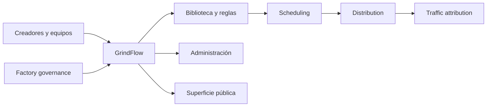

# GrindFlow

> SaaS multi-tenant para gestionar contenido, distribución programada, atribución de tráfico y operaciones de ingresos.

**Rol en la fábrica:** product · **Fase:** construction · **Roadmap:** [GitHub Issue #2](https://github.com/pl0n3r/GrindFlow/issues/2)

**Versión de código declarada:** V0.1.221 ([`config/version.php`](config/version.php)); la versión candidata `v0.1.220` renueva el home público con la parrilla de programación ([sistema visual](docs/DISENO-PARRILLA.md)); no demuestra el SHA desplegado ni salud de producción.

GrindFlow ayuda a creadores y equipos a cargar contenido una vez, organizarlo, programar su distribución y medir el tráfico hacia destinos configurados, manteniendo control humano sobre reglas, permisos y publicación.

## Operational Cockpit

[](https://github.com/pl0n3r/GrindFlow/actions/workflows/grindflow-ci.yml?query=branch%3Amain)
[](https://github.com/pl0n3r/GrindFlow/releases)

[GitHub Actions](https://github.com/pl0n3r/GrindFlow/actions) · [Releases](https://github.com/pl0n3r/GrindFlow/releases) · [Orquestador de ControlBot (acceso restringido)](https://control.condorapp.com.co/)

Las insignias consultan fuentes vivas; **no** certifican despliegue, recuperación, preparación del piloto ni salud integral. Omitimos /health porque no se ha acreditado un endpoint público seguro.

## Work Queue

- **NOW:** [issues abiertos y su prioridad vigente](https://github.com/pl0n3r/GrindFlow/issues?q=is%3Aissue+is%3Aopen), con reserva y CI por PR, no por esta portada.
- **NEXT:** [MVP técnico #250](https://github.com/pl0n3r/GrindFlow/issues/250) y su ruta Library → Scheduling → Distribution, con aceptación por integración.
- **LATER:** [roadmap maestro #2](https://github.com/pl0n3r/GrindFlow/issues/2) y [transición a Symfony](docs/STACK-TRANSITION-SYMFONY.md) por slices.
- **BLOCKED:** las decisiones B de [cohorte real #271](https://github.com/pl0n3r/GrindFlow/issues/271) y [publicación externa #453](https://github.com/pl0n3r/GrindFlow/issues/453) no autorizan participantes, datos reales ni posts en Facebook.

Esta vista resume el trabajo; no sustituye el roadmap, los Issues ni las Releases.

## Qué hace el producto

GrindFlow gestiona el ciclo de vida de contenido multimedia para equipos y creadores: biblioteca y organización de recursos, programación, distribución a destinos configurados, enlaces rastreables, atribución de tráfico y soporte a operaciones de ingresos. La especificación durable está en [`docs/GRINDFLOW-SPEC.md`](docs/GRINDFLOW-SPEC.md) y los requisitos verificables en [`docs/REQUIREMENTS.md`](docs/REQUIREMENTS.md).

## Arquitectura en 60 segundos



La arquitectura objetivo es un monolito modular API-first. La transición tecnológica conserva el runtime existente hasta demostrar paridad y cutover; el README no convierte un objetivo arquitectónico en estado desplegado.

### Library, Scheduling y Distribution · transición segura

El código incluye [colecciones y variantes de Library #414](https://github.com/pl0n3r/GrindFlow/issues/414) y [vigencia UTC de assets #407](https://github.com/pl0n3r/GrindFlow/issues/407), entregas fusionadas. La ruta [Composer Symfony → Facebook Pages #260](https://github.com/pl0n3r/GrindFlow/issues/260) y la [entrega técnica MVP #250](https://github.com/pl0n3r/GrindFlow/pull/258) cuentan con implementación, **no** con autorización para publicación externa, cohorte real o go-live: rigen las decisiones de [#271](https://github.com/pl0n3r/GrindFlow/issues/271) y [#453](https://github.com/pl0n3r/GrindFlow/issues/453).

La readiness S4 `forbidden` es una señal fail-closed de configuración y publicación; solo evidencia de Production Smoke y el SHA efectivamente desplegado permiten acreditar su superación. El README no certifica esos hechos.

La fuente técnica de los límites del piloto y la separación entre código y runtime está en [AGENTS.md](AGENTS.md) y [STACK-TRANSITION-SYMFONY.md](docs/STACK-TRANSITION-SYMFONY.md).

## Stack e infraestructura

- **Objetivo backend:** PHP 8.5 + Symfony 7.4 LTS + Doctrine ORM/DBAL/Migrations.
- **Datos:** MariaDB.
- **Administración objetivo:** React + TypeScript + Vite.
- **Público objetivo:** Twig/SSR.
- **Transición:** Laravel y el legado Next.js continúan operativos hasta paridad y cutover verificados.
- **Hosting inicial:** Hostinger, con portabilidad prevista por la arquitectura.
- **CI/gobernanza:** GitHub Actions consumiendo contratos reutilizables de Factory.

La fuente técnica de la transición es [`docs/STACK-TRANSITION-SYMFONY.md`](docs/STACK-TRANSITION-SYMFONY.md); no se infiere estado de producción desde esta sección.

## Ciclo de entrega

Issue → reserva canónica → rama enfocada → PR → gates de GrindFlow/Factory → revisión → squash merge serial → verificación exact-main → release/deploy cuando aplique → smoke/observer → estado operativo basado en evidencia.

Las reglas ejecutables del ciclo están en [`AGENTS.md`](AGENTS.md) y la gobernanza durable en [`docs/GOVERNANCE.md`](docs/GOVERNANCE.md).

## Calidad y seguridad

- `GrindFlow CI / validate` agrega los gates seleccionados por alcance; Sonar y CodeRabbit aportan revisión adicional.
- Los secretos y credenciales viven fuera del repositorio y no se publican en README, Issues ni logs.
- Cambios de datos, despliegue y producción respetan migraciones, backup/restore, rollback y smoke definidos por la documentación operativa.
- La salud operativa agregada y el handoff seguro se definen en [`docs/PRODUCTION-OPERATIONS.md`](docs/PRODUCTION-OPERATIONS.md); recovery conserva su fuente en [`docs/PRODUCTION-RECOVERY.md`](docs/PRODUCTION-RECOVERY.md).
- Estado desconocido falla cerrado: un badge, una versión o un merge no demuestran por sí solos salud ni despliegue.

Consulta [`AGENTS.md`](AGENTS.md), [`decisiones.yml`](decisiones.yml) y [`docs/GOVERNANCE.md`](docs/GOVERNANCE.md) para las reglas vigentes.

## Roadmap y fuentes de verdad

- **Roadmap canónico:** [Issue #2](https://github.com/pl0n3r/GrindFlow/issues/2).
- **Especificación:** [`docs/GRINDFLOW-SPEC.md`](docs/GRINDFLOW-SPEC.md).
- **Requisitos:** [`docs/REQUIREMENTS.md`](docs/REQUIREMENTS.md).
- **Modelo de desarrollo:** [`docs/DEVELOPMENT-MODEL.md`](docs/DEVELOPMENT-MODEL.md).
- **Decisiones vigentes:** [`decisiones.yml`](decisiones.yml).
- **Contrato operativo para agentes:** [`AGENTS.md`](AGENTS.md).
- **Documentación profunda:** [`docs/`](docs/).

El README enlaza estas fuentes; no las duplica ni funciona como changelog.

## Desarrollo local

Para el frontend/legado Node declarado actualmente en `package.json`:

```bash
npm ci
npm run validate
```

Los comandos y gates PHP/Symfony vigentes se mantienen en [`AGENTS.md`](AGENTS.md) y en la documentación de transición. Ejecuta solo los gates correspondientes al área modificada; no uses una ejecución local como evidencia de producción.

## Mapa de la fábrica

- **Factory:** governance/kit y contratos reutilizables.
- **ControlBot:** control plane privado de proyectos, trabajo, decisiones e incidentes.
- **FactoryRunner:** execution plane.
- **Condor:** producto.
- **GrindFlow:** **producto actual**, enfocado en contenido, distribución y tráfico.
- **BRVTAL:** producto.
- **AutoFactory:** herramienta local/manual.

Cada repositorio conserva su responsabilidad; GrindFlow consume gobernanza de Factory sin convertirse en un segundo control plane.
